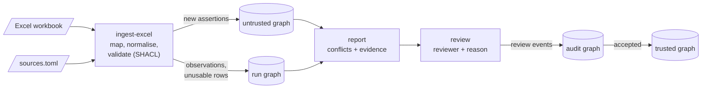

# Employee Knowledge

A provenance-first employee knowledge graph. It ingests Excel workbooks, maps records to
an employee ontology, keeps accepted and unreviewed assertions separate, and reports
conflicting values with source evidence.

It currently includes configured Excel ingestion with per-run provenance, an RDF
ontology with SHACL validation, immutable assertions, audited review actions, a
discrepancy report, two synthetic sample workbooks and tests.

Confluence, Jira and Power BI have connector placeholders only. Before enabling them,
define read-only access scopes, credentials, source ownership and field mappings.

## Why

Employee information lives in many systems that disagree. Merging them into one "golden
record" silently picks winners and discards the evidence. Employee Knowledge keeps every
source's value instead, and makes trust an explicit, recorded decision:

- **Every value is evidence.** Each value keeps its source: workbook, sheet, row, the
  exact source text and the ingestion run. Nothing is overwritten.
- **Conflicts stay visible.** When sources disagree, both values are kept and reported
  with their evidence. Nothing picks the newest value or a favoured source.
- **Trust is earned per fact.** A fact becomes trusted only when a named reviewer
  accepts it with a reason, and that decision is audited. No source is trusted
  wholesale, and AI may suggest but never promote.
- **Identity is conservative.** Records match only on the organisation-issued employee
  ID, never on names or job titles.
- **Everything is reproducible.** Re-ingesting the same file changes nothing, and the
  trusted view can always be rebuilt from the audit log.

Data owners get a list of where their systems disagree; auditors get who decided what,
when and why; the trusted query answers from reviewed facts only and says when values
conflict or are still unreviewed. Later AI features will also say when evidence is stale.

## Trust model

Every ingested value is a separate assertion that starts untrusted and becomes trusted
only through an explicit, audited review. See [docs/trust-model.md](docs/trust-model.md).



Graph membership is a projection of the audit events; `rebuild-projection` recomputes
it.

## Privacy

Synthetic people only. Never commit real employee data, graph stores, exports, reports or
credentials.

## Quick start

Requires Python 3.11+ and [uv](https://docs.astral.sh/uv/).

```bash
uv sync --extra dev
mkdir -p config && cp examples/sources.toml config/sources.toml
uv run employee-knowledge ingest-excel examples/employees.xlsx --source-id hr-export
uv run employee-knowledge ingest-excel examples/employees-directory.xlsx --source-id people-directory
uv run employee-knowledge report
uv run pytest
uv run ruff check . && uv run ruff format --check .
```

The full walkthrough, including review, is in
[docs/operating.md](docs/operating.md#example-run). The local TriG store defaults to
`./data/employee-knowledge.trig`. Override it with `EMPLOYEE_KNOWLEDGE_STORE`.

## Pickle

Pickle is the development workflow layer, not part of the platform. The board is
[tickets/BOARD.md](tickets/BOARD.md); tickets are `EK-NNN`. Jira as a data source is
separate from Pickle's own board.

## Licence

MIT, see [LICENSE](LICENSE).

## Documentation

- [docs/](docs/): the product and how to operate it ([trust model](docs/trust-model.md),
  [operating guide](docs/operating.md), [source onboarding](docs/source-onboarding.md)).
- [development/](development/): [architecture](development/architecture.md),
  [roadmap](development/roadmap.md), [decisions](development/decisions/).
- [AGENTS.md](AGENTS.md): rules for coding agents.
